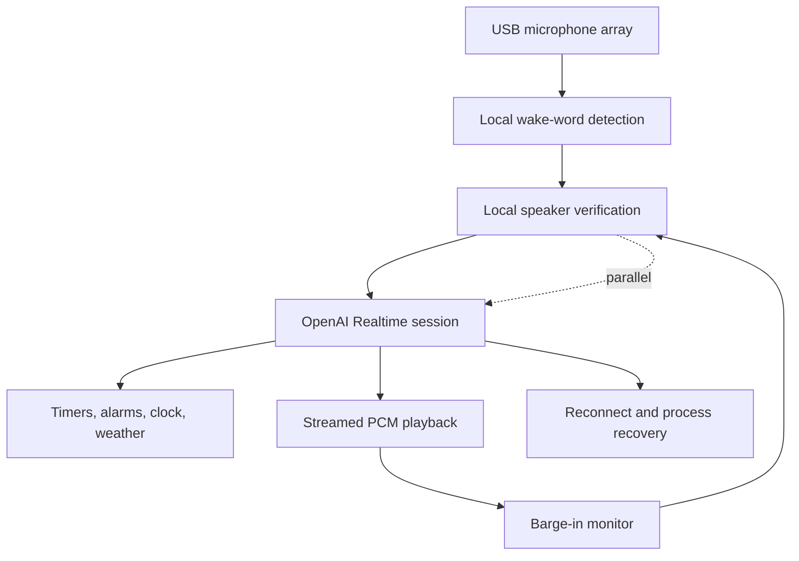

# Nexus Voice Assistant

Nexus is a self-hosted, always-on voice assistant built on the OpenAI Realtime API. It runs on a
Linux computer with a USB microphone array and ordinary speakers. Wake-word detection and speaker
verification run locally; the conversation and the spoken replies come from the Realtime API. It
was built to replace a smart speaker at home, so it is designed for quick replies, local control,
and running unattended as a system service.

## Features

- Dual-channel wake-word detection with configurable confidence thresholds
- Local speaker verification using SpeechBrain ECAPA embeddings
- OpenAI Realtime audio input, tool calls, and streamed speech output
- Hands-free follow-up window after each reply, with the microphone open immediately
- Barge-in: saying the wake phrase stops playback locally and cancels the reply on the server
- Alarms and countdown timers that survive restarts, plus clock, saved location, and weather tools
- Say the wake phrase to silence a ringing timer or alarm
- Finds audio devices by name
- Exponential reconnect backoff for brief network failures
- Starts a new session at once when the Realtime API's maximum session length is reached
- Replaces the whole process after repeated WebSocket handshake failures
- Runs under systemd with persistent journald logs

## Hardware and requirements

The reference build uses:

- Dell OptiPlex running Debian Linux
- ReSpeaker XVF3800 four-microphone USB array
- Intel HDA analog audio output
- PipeWire/WirePlumber audio stack
- systemd for startup and supervision

Other microphones and speakers should work. Device names are matched by a name fragment, and every
device name and model path can be changed with environment variables. The XVF3800's
echo-cancellation reference output is optional: set `NEXUS_AEC_REFERENCE_NAME=off` for a
microphone without a playback endpoint.

Software:

- Python 3.9 or newer
- PortAudio and your distribution's audio packages
- An OpenAI API key with Realtime access (usage is billed by OpenAI)
- Your own wake-word model and voice profiles (see below)

### Models you supply

These files are personal and are never committed:

- **Wake-word model.** An [openWakeWord](https://github.com/dscripka/openWakeWord) `.onnx` model
  for your wake phrase. The default path is `models/hey_nexus.onnx`.
- **Voice profiles.** One SpeechBrain ECAPA speaker embedding per microphone channel, saved with
  `torch.save` as a tensor (or a dict with an `embedding` key): `models/voice_ch0.pt` and
  `models/voice_ch1.pt`. There is no enrollment tool yet.
- **Speaker model cache.** SpeechBrain downloads `spkrec-ecapa-voxceleb` to
  `models/spkrec-ecapa-voxceleb` on first run.

## Install and run

```bash
git clone https://github.com/RyanYarbery/Nexus-Voice-Assistant.git
cd Nexus-Voice-Assistant
python3 -m venv .venv
source .venv/bin/activate
pip install --upgrade pip
pip install torch --index-url https://download.pytorch.org/whl/cpu
pip install -r requirements.txt
```

On Linux a plain `pip install torch` pulls the multi-gigabyte CUDA build. Nexus runs on the CPU, so
install the CPU wheel first as shown.

1. Put your wake-word model and voice profiles under `models/`, or point the environment variables
   at them.
2. Copy `.env.example` to a private file (for example `~/.config/nexus/env`) and set
   `OPENAI_API_KEY`.
3. Set `NEXUS_MIC_NAME` and `NEXUS_SPEAKER_NAME` to a fragment of your devices' names.
4. Run it in a terminal first to check audio and model loading. Export the variables you changed,
   at least the key:

   ```bash
   export OPENAI_API_KEY="your-key-here"
   python echo.py
   ```

5. For unattended use, adapt `systemd/nexus.service.example` (user, paths, environment file) and
   install it as a system service. The unit loads your environment file with `EnvironmentFile=`.

A sample of the console output is in `docs/sample-session.txt`.

## Configuration

- **`.env.example`** lists every environment variable with its default and a short note. Only
  `OPENAI_API_KEY` is required.
- **`settings.example.json`** shows the shape of `settings.json`, which holds the saved location for
  weather and local time. You don't need to write it by hand: ask Nexus to set your location and it
  saves the file.
- **`alarms.example.json`** is an empty alarm store. `alarms.json` and `timers.json` are written as
  alarms and timers change.
- **`systemd/nexus.service.example`** is a service template with `YOUR_USER` placeholders.

`settings.json`, `alarms.json`, `timers.json`, `.env` files and everything under `models/` are
listed in `.gitignore`.

## How it works



### Conversation flow

1. **Wake.** openWakeWord scores both capture channels on every 80 ms block. The 0.8 s pre-roll containing the phrase is kept.
2. **Stream.** In the default `soft` verification mode the pre-roll and live audio go to the Realtime API immediately. SpeechBrain ECAPA judges the enrolled speaker in parallel on the first 2.5 s, or on whatever has arrived when the server's voice-activity detection reports the end of speech. A rejected speaker cancels the request and clears the server buffer; nothing is spoken. `strict` restores the original behaviour of holding the request until 1.2 s has been verified, and `off` disables verification.
3. **Speak.** Audio deltas are resampled with a stateful polyphase filter and played as they arrive after a 0.3 s pre-buffer, so the first words start while the rest is still generating. The same audio is mirrored to the XVF3800's USB playback endpoint as the far-end reference for its hardware echo canceller.
4. **Interrupt.** Saying the wake phrase while Nexus speaks aborts playback within one 50 ms chunk, sends `response.cancel` if the server is still generating, and opens the microphone at once. Speech captured in the moment after the interruption is sent first so nothing is lost.
5. **Follow up.** After each reply the microphone stays open to the server for five seconds, verified the same way, so a second request needs no wake word.

### Reliability

OpenAI Realtime sessions have a finite lifetime. Nexus treats a maximum-duration event as a connection failure and starts a new session immediately. A socket the server closes cleanly is detected the same way, so Nexus never idles on a dead connection. Ordinary connection failures use capped exponential backoff.

After speaker verification, microphone audio streams to the Realtime API only until server-side voice activity detection reports speech. If no speech is detected within ten seconds, Nexus stops uploading and returns to wake-word listening.

Alarms and timers are written to `alarms.json` and `timers.json` as they change, so a restart restores them. A timer that came due while Nexus was down still rings if it is less than ten minutes late.

Some long-running audio and ML workloads can enter a degraded state where new WebSocket handshakes continue timing out even though ordinary HTTPS remains healthy. After three consecutive opening-handshake timeouts, Nexus exits immediately. The accompanying systemd policy then replaces the complete process group, reinitializing the audio, wake-word, speaker-recognition, DNS, TLS, and WebSocket state.

## Repository layout

```text
.
├── echo.py                         Main application
├── requirements.txt               Python dependencies
├── .env.example                   Configuration template
├── alarms.example.json            Empty alarm-store example
├── settings.example.json          Settings example (saved location)
├── systemd/
│   └── nexus.service.example      Service template
├── tests/
│   ├── test_units.py              Resampler, timer persistence, helpers
│   └── test_flow.py               Hardware-free state-machine scenarios
└── docs/
    └── sample-session.txt         Sample console output
```

## Tests

Both suites run without a microphone, speakers, OpenAI, or the ML models. See `tests/README.md`.

```bash
python -m venv .venv-test && .venv-test/bin/pip install numpy scipy
.venv-test/bin/python tests/test_units.py
.venv-test/bin/python tests/test_flow.py
```

## Security and privacy

- The API key is read from `OPENAI_API_KEY`; it is not hard-coded.
- Speaker embeddings are biometric data and must not be committed.
- Saved locations, alarm data, and timer data stay local and are ignored by Git.
- Tool logs redact sensitive arguments where appropriate.
- `.gitignore` blocks the model, recording, credential, state, and backup formats the project uses.
- Microphone audio goes to OpenAI only after the wake word and during the follow-up window.

Before publishing changes, inspect the staged content:

```bash
git diff --cached
git grep -nEi 'api[_-]?key|password|secret|token|bearer'
```

## Status

Nexus is deployed as an always-on household assistant on the reference hardware. Wake detection, speaker verification, Realtime conversation, audio playback, timers, persistent alarms, weather lookup, follow-up speech, barge-in, automatic reconnection, and systemd recovery have all been exercised there.

### Getting closer to a commercial smart speaker

The remaining gap to an Echo-class device is mostly outside the software:

- **Play through the array.** Powered speakers on the XVF3800's 3.5 mm jack make its own DAC the far-end reference, on one clock with a fixed delay. That is the architecture the chip is designed for and removes the Dell output path and the dual-stream drift problem entirely.
- **Wake model.** Retrain the openWakeWord model with room impulse responses and noise augmentation and raise the threshold, or build a custom keyword with Picovoice Porcupine. Run detection on the processed channel only once the model is strong enough.
- **Tune once with the XMOS procedure.** Route the canceller's reference (output category 12) and a raw microphone (category 3) to the two channels, record during playback, and check level and alignment.
- **Acoustics.** Keep the array off the speakers' surface, at moderate volume, with drivers that do not distort. Nonlinear distortion is the one echo component the canceller cannot remove.
- **Feedback.** Direction of arrival and the twelve-LED ring are available over USB control and would replace the sudo route helper with a udev rule.

### Future improvements

- Split the single-file prototype into testable modules
- Convert the scripts in `tests/` to pytest and add connection-manager coverage
- Add a LICENSE file
- Package hardware-specific ReSpeaker routing separately
- Add structured logging and health metrics
- Provide a guided speaker-enrollment utility

## About this project

This is a personal project by Ryan Yarbery, shared as-is in case it helps someone building their
own assistant. It is not a product, it is tuned for one home's hardware, and it comes with no
support.
