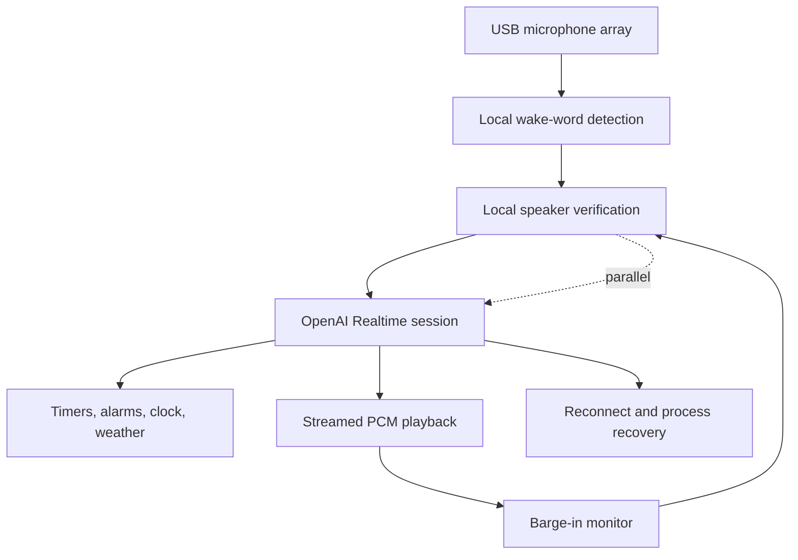

# Nexus Voice Assistant

Nexus is a self-hosted, always-on voice assistant built around the OpenAI Realtime API. It runs on a Linux computer with a USB microphone array and conventional speakers, combining local wake-word detection and speaker verification with cloud-based conversational reasoning and speech.

The project began as a practical replacement for a household smart speaker. Its design emphasizes low-latency conversation, local control, recoverability, and operation as a long-running system service.

## Highlights

- Dual-channel wake-word detection with configurable confidence thresholds
- Local speaker verification using SpeechBrain ECAPA embeddings
- OpenAI Realtime audio input, tool calls, and streamed speech output
- Hands-free follow-up window after each response, with the microphone open immediately
- Barge-in that stops playback locally and cancels the reply on the server
- Persistent alarms and countdown timers that survive restarts, plus clock, saved location, and weather tools
- Say the wake phrase to silence a ringing timer or alarm
- Automatic audio-device discovery by device name
- Exponential reconnect backoff for transient failures
- Immediate recovery from the Realtime API's maximum session duration
- Full process replacement after repeated WebSocket handshake failures
- Continuous operation under systemd with persistent journald logs

## Architecture



## Reference hardware

The production installation uses:

- Dell OptiPlex running Debian Linux
- ReSpeaker XVF3800 four-microphone USB array
- Intel HDA analog audio output
- PipeWire/WirePlumber audio stack
- systemd for startup and supervision

Device names and all private model paths can be overridden with environment variables. The XVF3800's echo-cancellation reference output is optional: set `NEXUS_AEC_REFERENCE_NAME=off` for a microphone without a playback endpoint.

## Repository layout

```text
.
├── echo.py                         Main application
├── requirements.txt               Python dependencies
├── .env.example                   Safe configuration template
├── alarms.example.json            Empty alarm-store example
├── settings.example.json          Sanitized settings example
├── systemd/
│   └── nexus.service.example      Service template
├── tests/
│   ├── test_units.py              Resampler, timer persistence, helpers
│   └── test_flow.py               Hardware-free state-machine scenarios
└── docs/
    └── sample-session.txt         Sanitized runtime example
```

Wake-word models, speaker embeddings, downloaded ML models, recordings, credentials, saved locations, active alarms, logs, and virtual environments are intentionally excluded from version control.

## Setup overview

1. Install Python 3.9 or newer and the system audio dependencies for your Linux distribution, including PortAudio.
2. Create a Python virtual environment and install `requirements.txt`.
3. Place your wake-word model and enrolled speaker embeddings under `models/`, or configure their paths through environment variables.
4. Copy `.env.example` to a private environment file and add `OPENAI_API_KEY`.
5. Adjust the microphone and speaker name fragments for your devices.
6. Run `python echo.py` interactively to verify audio and model loading.
7. Adapt `systemd/nexus.service.example` for unattended operation.

Example environment setup:

```bash
python3 -m venv .venv
source .venv/bin/activate
pip install --upgrade pip
pip install torch --index-url https://download.pytorch.org/whl/cpu
pip install -r requirements.txt
export OPENAI_API_KEY="your-key-here"
python echo.py
```

## Conversation flow

1. **Wake.** openWakeWord scores both capture channels on every 80 ms block. The 0.8 s pre-roll containing the phrase is kept.
2. **Stream.** In the default `soft` verification mode the pre-roll and live audio go to the Realtime API immediately. SpeechBrain ECAPA judges the enrolled speaker in parallel on the first 2.5 s, or on whatever has arrived when the server's voice-activity detection reports the end of speech. A rejected speaker cancels the request and clears the server buffer; nothing is spoken. `strict` restores the original behaviour of holding the request until 1.2 s has been verified, and `off` disables verification.
3. **Speak.** Audio deltas are resampled with a stateful polyphase filter and played as they arrive after a 0.3 s pre-buffer, so the first words start while the rest is still generating. The same audio is mirrored to the XVF3800's USB playback endpoint as the far-end reference for its hardware echo canceller.
4. **Interrupt.** Saying the wake phrase while Nexus speaks aborts playback within one 50 ms chunk, sends `response.cancel` if the server is still generating, and opens the microphone at once. Speech captured in the moment after the interruption is sent first so nothing is lost.
5. **Follow up.** After each reply the microphone stays open to the server for five seconds, verified the same way, so a second request needs no wake word.

## Reliability design

OpenAI Realtime sessions have a finite lifetime. Nexus treats a maximum-duration event as a connection failure and starts a new session immediately. A socket the server closes cleanly is detected the same way, so Nexus never idles on a dead connection. Ordinary connection failures use capped exponential backoff.

After speaker verification, microphone audio streams to the Realtime API only until server-side voice activity detection reports speech. If no speech is detected within ten seconds, Nexus stops uploading and returns to wake-word listening.

Alarms and timers are written to `alarms.json` and `timers.json` as they change, so a restart restores them. A timer that came due while Nexus was down still rings if it is less than ten minutes late.

Some long-running audio and ML workloads can enter a degraded state where new WebSocket handshakes continue timing out even though ordinary HTTPS remains healthy. After three consecutive opening-handshake timeouts, Nexus exits immediately. The accompanying systemd policy then replaces the complete process group, reinitializing the audio, wake-word, speaker-recognition, DNS, TLS, and WebSocket state.

## Security and privacy

- The API key is read from `OPENAI_API_KEY`; it is not hard-coded.
- Speaker embeddings are biometric data and must not be committed.
- Saved locations, alarm data, and timer data remain local and are ignored by Git.
- Tool logs redact sensitive arguments where appropriate.
- `.gitignore` blocks the common model, recording, credential, state, and backup formats used by the production installation.

Before publishing changes, inspect the staged content:

```bash
git diff --cached
git grep -nEi 'api[_-]?key|password|secret|token|bearer'
```

## Current status

Nexus is deployed as an always-on household assistant. Wake detection, speaker verification, Realtime conversation, audio playback, timers, persistent alarms, weather lookup, follow-up speech, barge-in, automatic reconnection, and systemd recovery have all been exercised on the reference hardware.

## Getting closer to a commercial smart speaker

The remaining gap to an Echo-class device is mostly outside the software:

- **Play through the array.** Powered speakers on the XVF3800's 3.5 mm jack make its own DAC the far-end reference, on one clock with a fixed delay. That is the architecture the chip is designed for and removes the Dell output path and the dual-stream drift problem entirely.
- **Wake model.** Retrain the openWakeWord model with room impulse responses and noise augmentation and raise the threshold, or build a custom keyword with Picovoice Porcupine. Run detection on the processed channel only once the model is strong enough.
- **Tune once with the XMOS procedure.** Route the canceller's reference (output category 12) and a raw microphone (category 3) to the two channels, record during playback, and check level and alignment.
- **Acoustics.** Keep the array off the speakers' surface, at moderate volume, with drivers that do not distort. Nonlinear distortion is the one echo component the canceller cannot remove.
- **Feedback.** Direction of arrival and the twelve-LED ring are available over USB control and would replace the sudo route helper with a udev rule.

## Future improvements

- Split the single-file prototype into testable modules
- Convert the scripts in `tests/` to pytest and add connection-manager coverage
- Add a LICENSE file
- Package hardware-specific ReSpeaker routing separately
- Add structured logging and health metrics
- Provide a guided speaker-enrollment utility

## Author

Ryan Yarbery
